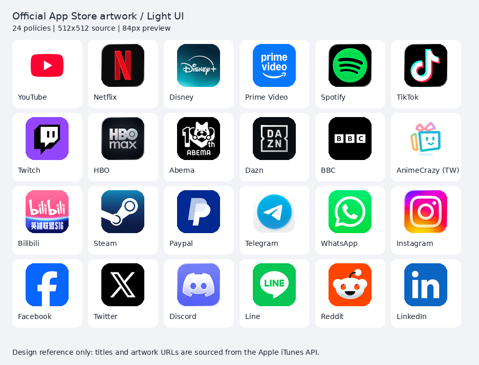
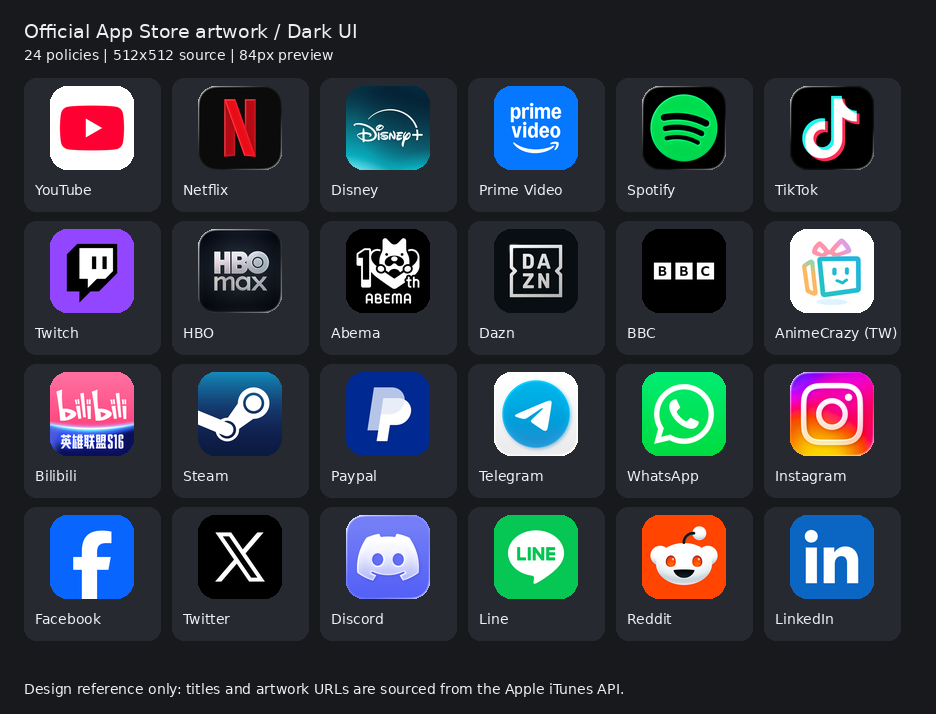

# Loon Routing DNS · 官方 App Store 图标与自制图标视觉审核（2026-10-18）

> 本报告仅用于设计检查；不是商标授权判断、App Store 官方认证或 Loon 真机验收。正式配置 `main` 不受影响。

## 24 枚官方图标参照

来源为 2026-10-18 对照当日 iTunes Search API 的 App ID 与 `artworkUrl512`。PNG 文件均可成功读取，图册按 iOS 圆角作预览掩膜，素材没有被复制到正式 `icons/` 目录。

### 共同点是什么

1. **结构性的共性**：有清楚的背景、辨识度高的主体、圆角外形、小尺寸可读性；不是全体使用同一种材质或颜色。
2. **品牌优先**：Netflix 的黑底红 N、Spotify 的黑底绿标、TikTok 的黑底音符、X 的黑底字母；Facebook、WhatsApp、Twitch、LinkedIn 等使用稳定的品牌色；YouTube、Telegram、动画疯是明显的亮底体系。
3. **主题图形不是通用模板**：BBC/DAZN/HBO/Prime Video 使用字标，Reddit/ABEMA/动画疯使用特殊角色或形象，Instagram 使用品牌化渐变。
4. **适配深浅色≠改换颜色**：在暗色列表中，黑底图标和背景存在低对比边界，但主体仍有清晰的视觉锚点；亮底图标在暗色列表中也不会因为颜色不同而失去系列协调性。
5. **一致是质量和辨识度一致**：不要强求色板、几何主体、背景纹理、投影、标识占比全部相同。

### 对照之后，自制版本的问题

| 名称 | 过去的主要问题 | 新的语义及构图方向 |
|---|---|---|
| Proxy | 圆环箭头与 Auto 难区分；也曾使用两条连接线合并成箭头 | 精简为独立的「中继/转发」识别标记，避免与 Auto 共用圆环箭头 |
| Auto | 速度表可能误导为实时测速，圆环箭头也和 Proxy 相似 | 三个候选之中的唯一优选 / 自动决策，主体是明确的选择关系 |
| Fallback | 和 Proxy 使用相近的起点、分支、箭头，双路结构过度相似 | 故障切换的主备关系，视觉上主路失效、备路接续 |
| AdBlock | 大面积亮红 + 盾牌与禁令双符号重叠，画面压迫感强 | 以负空间表达拦截，一个主符号足够；减少装饰 |
| Final | 路线+地图定位针与路由和导航 App 语义重叠 | 规则落点/最终裁决，用终止标记或独立的落点结构，而不是长路线 |
| AI | 网络节点、芯片、星芒叠加；容易与 Console 混淆 | 单独的智能聚合语义，避免重复「线路包围芯片」结构 |
| Google | 自画伪立体 G 和官方品牌不一致 | 使用可核验的品牌原始标志素材；保留正确几何比例 |
| Microsoft | 人为发光/渐变的四宫格比官方品牌更臃肿 | 官方四格品牌素材，谨慎处理底板 |
| Apple | 银色浮雕+统一波纹是人为套材质 | 官方标志的精确比例和轮廓，选对背景对比 |
| Console 插件 | 又是蓝底滑块 + 网络节点，缺少项目识别，和 Proxy 很像 | 首先独立设计 Loon Routing DNS 专属项目标记，再在插件中使用；不要把控件截图当品牌 Logo |

### 新的约束

- **一张图只能有一个视觉中心**，禁止为了“科技感”叠加多种符号。
- **禁止整组套用相同的大色块、波浪、光泽、浮雕阴影**。
- **用色从语义和品牌出发**：核心功能图标可以存在联系，但必须有独立的轮廓和识别锚点。
- **主体大小视形状做光学调整**，不以固定像素占比强迫它们一致。
- **以 42–64px 及 24–32px 小尺寸检查**，同时在深浅背景上看黑白层次。
- **不要以“截图有圆角”冒充合规**：原始主文件建议采用矢量或大尺寸无损稿；在确认 Loon 是否自行裁角后仅处理一次圆角，避免重复蒙版导致锯齿。
- **由项目主标确定插件形象**，而不是给插件制作又一个泛用控制面板图标。
- **品牌图标优先采用官方素材，不重画现成品牌 Logo**；有许可问题再作单独处理。

## 设计执行顺序

先单独确定 Console 项目标记，再分别做 Proxy、Auto、Fallback 的互不雷同轮廓草图；至少对照两种系统主题的 24 枚参考图，看缩小后的真实排序。通过后再继续 AdBlock、Final、AI。Google、Microsoft、Apple 的品牌标志优先以核验过的官方资源处理，而非生成近似物。

## Apple 设计参考

- [Apple App Icons HIG](https://developer.apple.com/design/human-interface-guidelines/app-icons)
- [Apple Branding HIG](https://developer.apple.com/design/human-interface-guidelines/branding)

## 状态

目前只在 `audit/appstore-icon-quality-20261018` 分支保存审核脚本和参考图，**没有替换项目正式图标**。
